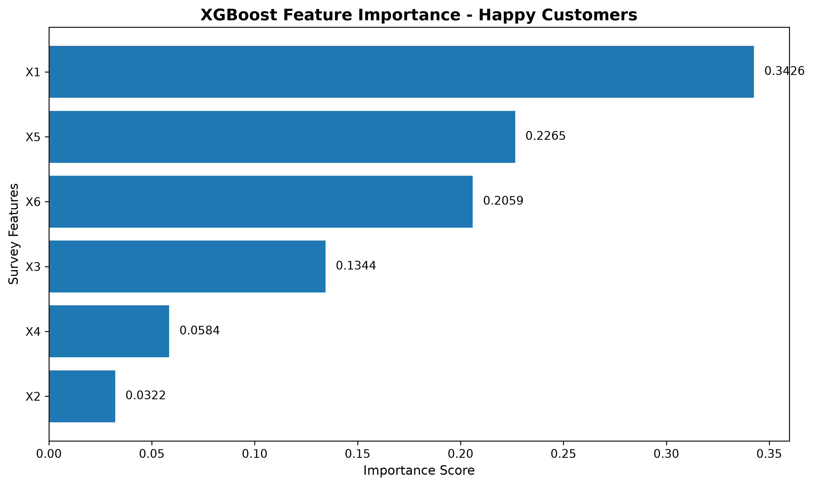

# Customer Happiness Prediction Using XGBoost

**Developing and Evaluating a Machine Learning Classification Model to Predict Customer Happiness and Support Data-Driven Customer Experience Improvements**

---

## 1. Project Overview

Customer satisfaction is an important indicator of business performance, customer retention, and long-term growth. Understanding the factors associated with positive customer experiences enables organizations to identify service improvement opportunities and make informed business decisions.

This project was completed as part of my AI Residency at **Apziva**. The objective was to develop a supervised machine learning classification model capable of predicting customer happiness using the ACME Happiness Survey 2020 dataset.

Using Python and XGBoost (Extreme Gradient Boosting), I developed a binary classification model to predict whether customers reported a positive experience based on six survey responses.

The project focused on:

- Preparing and analyzing structured customer survey data.
- Developing and configuring an XGBoost classification model.
- Evaluating model performance using multiple classification metrics.
- Analyzing prediction probabilities and classification thresholds.
- Comparing model performance against a majority-class baseline.
- Examining feature importance to identify the survey variables most influential in model predictions.

### Project Success Criterion

The primary performance requirement established by Apziva was:

**Achieve an accuracy score of 73% or higher, or demonstrate why an alternative solution provides superior predictive value.**

The final XGBoost model achieved **73.08% accuracy on the independent test dataset**, meeting the established performance benchmark.

In addition, the model outperformed the majority-class baseline by 19.23 percentage points, demonstrating that it learned predictive patterns beyond simply assigning every observation to the most frequently occurring class.

---

## 2. Business Problem

Organizations collect customer feedback to understand satisfaction levels and identify opportunities for service improvement. However, identifying patterns associated with positive customer experiences can be challenging.

The business problem addressed in this project was:

**Can machine learning identify patterns in customer survey responses that help predict whether a customer is likely to report a positive experience?**

A predictive classification model could potentially help organizations:

- Identify patterns associated with positive and negative customer experiences.
- Understand which aspects of the ordering and delivery experience are most influential in predictions.
- Identify potential areas for customer experience improvement.
- Support data-driven operational and customer satisfaction decisions.

The model is intended to support customer experience analysis rather than replace direct customer feedback or establish causal relationships.

---

## 3. Project Objectives

The primary objectives were to:

1. Prepare the customer survey dataset for supervised machine learning.
2. Develop an XGBoost binary classification model.
3. Configure model hyperparameters to control complexity and improve generalization.
4. Generate prediction probabilities to examine classification confidence.
5. Evaluate classification thresholds and their impact on model performance.
6. Achieve or exceed the established 73% accuracy benchmark.
7. Compare model performance against a majority-class baseline.
8. Evaluate predictive performance using accuracy, precision, recall, F1 score, and balanced accuracy.
9. Examine feature importance to identify the strongest predictors of customer happiness.

---

## 4. Dataset Description

**Dataset:** ACME Happiness Survey 2020

The dataset contains customer survey responses collected to evaluate satisfaction with an ordering and delivery experience.

It consists of six independent predictor variables (X1–X6) and one dependent target variable (Y).

### Target Variable

| Variable | Description | Values |
|---|---|---|
| Y | Customer happiness classification | 0 = Unhappy, 1 = Happy |

### Feature Descriptions

| Feature | Description |
|---|---|
| X1 | My order was delivered on time. |
| X2 | Contents of my order were as I expected. |
| X3 | I ordered everything I wanted to order. |
| X4 | I paid a good price for my order. |
| X5 | I am satisfied with my courier. |
| X6 | The app makes ordering easy for me. |

These six features represent different dimensions of the customer experience, including delivery performance, order accuracy, order completeness, price satisfaction, courier satisfaction, and application usability.

---

## 5. Technologies and Tools

| Technology | Purpose |
|---|---|
| Python | Primary programming language |
| Pandas | Dataset loading and data manipulation |
| NumPy | Numerical operations and probability analysis |
| Scikit-learn | Data splitting and model evaluation |
| XGBoost | Gradient boosting classification |
| Git and GitHub | Version control and project documentation |

### Machine Learning Algorithm: XGBoost

XGBoost is an optimized gradient boosting algorithm that constructs an ensemble of decision trees sequentially, with subsequent trees attempting to correct errors made by preceding trees.

I selected XGBoost because it is well suited to structured tabular datasets and can identify nonlinear relationships and interactions between predictor variables.

Its regularization capabilities also provide mechanisms for controlling model complexity and reducing overfitting.

---

## 6. Machine Learning Methodology

The project followed a structured machine learning workflow, from data preparation through final model evaluation.

### Step 1: Data Preparation

The dataset was loaded into a Pandas DataFrame.

The independent variables and dependent target variable were separated:

- `X`: Six customer survey predictor variables.
- `y`: Customer happiness classification target (`Y`).

This established the input features and prediction target for supervised learning.

### Step 2: Training, Validation, and Testing

The dataset was divided into training, validation, and testing subsets using Scikit-learn's `train_test_split()`.

The initial split allocated:

| Dataset | Proportion |
|---|---:|
| Training | 80% |
| Testing | 20% |

The training subset was subsequently divided into fitting and validation data.

| Dataset | Overall Proportion |
|---|---:|
| Model fitting | 60% |
| Validation | 20% |
| Final testing | 20% |

The following configuration was used:

- Test size: 20%
- Random state: 21
- Stratification: Enabled

Stratified sampling preserved the target-class distribution across the data subsets.

The validation subset was used to investigate prediction probabilities and classification threshold behavior. The independent test subset was reserved for final performance evaluation.

### Step 3: XGBoost Model Development

An XGBoost classifier was developed to predict customer happiness using the six survey features.

The final model configuration was:

```python
xgb_model = XGBClassifier(
    n_estimators=50,
    max_depth=2,
    learning_rate=0.03,
    min_child_weight=3,
    subsample=0.8,
    colsample_bytree=0.7,
    reg_lambda=3,
    scale_pos_weight=0.85,
    random_state=21,
    eval_metric="logloss",
    n_jobs=1
)
```

### Hyperparameter Configuration and Rationale

| Hyperparameter | Value | Purpose |
|---|---:|---|
| `n_estimators` | 50 | Number of boosting trees |
| `max_depth` | 2 | Controls individual tree complexity |
| `learning_rate` | 0.03 | Controls the contribution of each successive tree |
| `min_child_weight` | 3 | Controls the minimum instance weight required in a child node |
| `subsample` | 0.8 | Uses 80% of training observations per boosting iteration |
| `colsample_bytree` | 0.7 | Uses 70% of available features per tree |
| `reg_lambda` | 3 | Applies L2 regularization |
| `scale_pos_weight` | 0.85 | Adjusts positive-class weighting |
| `random_state` | 21 | Supports reproducibility |
| `eval_metric` | `logloss` | Evaluates probability prediction error |
| `n_jobs` | 1 | Restricts execution to one CPU thread |

The final configuration emphasizes controlling model complexity through shallow decision trees, a conservative learning rate, subsampling, and regularization.

### Step 4: Prediction Probability Analysis

Rather than relying exclusively on the model's default class predictions, I used XGBoost's `predict_proba()` method to examine predicted probabilities.

The probability associated with the positive class (customer happiness) was extracted for threshold evaluation.

```python
y_prob = xgb_model.predict_proba(X_val)[:, 1]
```

These probabilities represent the model's estimated likelihood that an observation belongs to the positive happiness class.

This provided the flexibility to investigate how different classification thresholds affect predictive performance.

### Step 5: Classification Threshold Evaluation

Binary classification models commonly use a default probability threshold of 0.50.

However, different thresholds can produce different trade-offs between accuracy, precision, and recall.

I evaluated alternative classification thresholds to understand their impact on model predictions and identify an appropriate decision threshold.

The classification rule was:

```python
y_pred = (y_prob >= threshold).astype(int)
```

The threshold evaluation considered the following metrics:

- **Accuracy:** Proportion of all predictions classified correctly.
- **Precision:** Proportion of positive predictions that were actually positive.
- **Recall:** Proportion of actual positive observations correctly identified.
- **F1 Score:** Harmonic mean of precision and recall.

For the final benchmark evaluation, I retained the standard **0.50 classification threshold**.

This provided a consistent benchmark for evaluating the final model without introducing an additional threshold adjustment to the reported test results.

### Step 6: Final Model Evaluation

After completing model development, the final XGBoost model was evaluated on the independent test dataset.

The model generated positive-class probabilities, which were converted into binary predictions using the 0.50 classification threshold.

Performance was evaluated using:

- Accuracy
- Precision
- Recall
- F1 Score
- Balanced Accuracy
- Classification Report
- Confusion Matrix

These metrics provided a broader understanding of model performance, including how effectively the classifier identified both happy and unhappy customers.

---

## 7. Final Model Performance and Business Impact

<details>
</details>

The final XGBoost model achieved **73.08% test accuracy**, meeting and exceeding Apziva's required performance benchmark of 73%.

### Success Metric Evaluation

| Performance Requirement | Result |
|---|---:|
| Required accuracy benchmark | 73.00% |
| Final test accuracy | **73.08%** |
| Benchmark status | Achieved |
| Classification threshold | 0.50 |

The model exceeded the required accuracy benchmark by 0.08 percentage points.

### Final Test Model Performance

| Evaluation Metric | Result |
|---|---:|
| Accuracy | **73.08%** |
| Precision | 76.92% |
| Recall | 71.43% |
| F1 Score | **74.07%** |
| Balanced Accuracy | 73.21% |
| Classification Threshold | 0.50 |

### Classification Report

| Class | Precision | Recall | F1 Score | Support |
|---|---:|---:|---:|---:|
| 0 (Unhappy) | 0.69 | 0.75 | 0.72 | 12 |
| 1 (Happy) | 0.77 | 0.71 | 0.74 | 14 |
| Macro Average | 0.73 | 0.73 | 0.73 | 26 |
| Weighted Average | 0.73 | 0.73 | 0.73 | 26 |

The model correctly classified 19 of the 26 test observations.

The F1 score of 74.07% demonstrates a reasonable balance between precision and recall, while the balanced accuracy of 73.21% indicates that the classifier performed comparably across both customer happiness classes.

### Confusion Matrix

```text
[[ 9  3]
 [ 4 10]]
```

| | Predicted Unhappy | Predicted Happy |
|---|---:|---:|
| Actual Unhappy | 9 | 3 |
| Actual Happy | 4 | 10 |

The confusion matrix shows that:

- 9 unhappy customers were correctly identified.
- 10 happy customers were correctly identified.
- 3 unhappy customers were incorrectly classified as happy.
- 4 happy customers were incorrectly classified as unhappy.

These results demonstrate that the model identified examples from both customer segments rather than exclusively predicting the majority class.

### Majority-Class Baseline Comparison

To determine whether the model provided predictive value beyond a simple classification strategy, I compared its performance against a majority-class baseline.

The majority-class baseline predicts the most frequently occurring target class for every observation.

In this dataset, the majority class was class 1 (Happy).

| Evaluation | Majority-Class Baseline | XGBoost Model |
|---|---:|---:|
| Correct Predictions | 14 | 19 |
| Total Predictions | 26 | 26 |
| Accuracy | 53.85% | **73.08%** |

**Accuracy Improvement: 19.23 percentage points**

The XGBoost model correctly classified five additional test observations compared with the majority-class baseline.

This comparison demonstrates that the model learned meaningful predictive patterns from customer survey responses rather than relying exclusively on the distribution of the target variable.

### Business Impact

The results demonstrate the potential value of applying machine learning to customer experience analysis.

By identifying patterns associated with customer happiness, organizations can use predictive insights to:

- Investigate service factors associated with positive customer experiences.
- Identify potential weaknesses in delivery and courier operations.
- Evaluate customer perceptions of application usability.
- Prioritize areas for further customer experience investigation.
- Support data-driven service improvement initiatives.

Although the model met the established success criterion, its predictions should be used as supplementary analytical insights rather than definitive assessments of individual customer satisfaction.

---

## 8. Feature Importance Analysis

Feature importance analysis was performed using the final XGBoost model to examine which survey variables contributed most to its predictive decisions.

### Feature Importance Results

| Feature | Importance | Relative Ranking |
|---|---:|---:|
| X1 | 0.342581 | 1 |
| X5 | 0.226518 | 2 |
| X6 | 0.205937 | 3 |
| X3 | 0.134367 | 4 |
| X4 | 0.058417 | 5 |
| X2 | 0.032179 | 6 |

### Feature Importance Visualization



### Key Findings

**1. Delivery Timeliness (X1) – 34.26%**

Delivery timeliness was the most influential feature in the model, representing approximately 34.26% of the reported feature importance.

This suggests that delivery performance was an important predictor of customer happiness within the dataset.

**2. Courier Satisfaction (X5) – 22.65%**

Courier satisfaction ranked second, indicating that customers' experiences with delivery personnel contributed substantially to the model's predictions.

**3. Application Usability (X6) – 20.59%**

Application usability ranked third, suggesting that the ease of placing orders through the application was another important predictive factor.

**4. Order Completeness (X3) – 13.44%**

Order completeness demonstrated a moderate contribution to the model's predictive decisions.

**5. Price Satisfaction (X4) – 5.84%**

Price satisfaction had a relatively smaller contribution to the model's predictions.

**6. Order Accuracy (X2) – 3.22%**

Order accuracy had the lowest reported feature importance among the six predictors.

### Business Interpretation

The feature importance results suggest that delivery timeliness, courier satisfaction, and application usability were the three strongest predictors of customer happiness in this model.

Together, these features accounted for approximately 77.50% of the model's reported feature importance.

From a business perspective, these findings suggest potential opportunities to investigate:

- Improving delivery reliability and timeliness.
- Strengthening courier service quality.
- Improving application usability and the ordering experience.

Feature importance measures predictive contribution within the trained model. These results do not establish that changes to individual features will directly cause improvements in customer happiness.

---

## 9. Model Evaluation Considerations and Limitations

An important aspect of this project was recognizing that classification performance should not be evaluated using accuracy alone.

### Evaluation Integrity

The dataset was divided into separate training, validation, and testing subsets.

The validation dataset supported model development and probability threshold analysis, while the independent test dataset was reserved for final evaluation.

After model development, the final model was retrained using the available training data, and its predictions were evaluated on the untouched test dataset.

The final benchmark evaluation used a fixed classification threshold of 0.50.

This separation helps reduce the risk of test-data leakage and provides a more independent assessment of model performance.

### Dataset Size

One important limitation is the relatively small dataset and independent test sample.

The final test dataset contained only 26 observations, meaning that each additional correct or incorrect prediction changes accuracy by approximately 3.85 percentage points.

Consequently, although the model achieved the required 73% accuracy benchmark, its performance should be interpreted cautiously.

A larger and more representative dataset would help provide a more reliable assessment of the model's generalization ability.

### Model Generalization

The reported results represent performance on one independent test split.

Additional validation using repeated stratified cross-validation and a larger dataset would help determine whether the model's performance remains consistent across different data partitions.

### Feature Importance Limitations

Feature importance identifies variables that contributed to the model's predictions. It does not establish causation or prove that a particular operational improvement will increase customer satisfaction.

Further analysis would be required to validate these findings and quantify their potential business impact.

---

## 10. Key Skills Demonstrated

### Machine Learning

- Supervised Learning
- Binary Classification
- XGBoost and Gradient Boosting
- Hyperparameter Configuration
- Model Regularization
- Predictive Modeling

### Data Science and Analytics

- Structured Dataset Preparation
- Exploratory Data Analysis
- Stratified Sampling
- Prediction Probability Analysis
- Classification Threshold Evaluation
- Feature Importance Analysis
- Business Insights and Interpretation

### Model Evaluation

- Accuracy
- Precision
- Recall
- F1 Score
- Balanced Accuracy
- Confusion Matrix Analysis
- Majority-Class Baseline Comparison
- Model Performance Evaluation

### Technical Tools

- Python
- Pandas
- NumPy
- Scikit-learn
- XGBoost
- Git and GitHub

---

## 11. Repository Structure

```text
t3EEhgPPsfuMSInm/
│
├── Project_HC.py
├── README.md
├── README_Happy_Customers.md
└── requirements.txt
```

The ACME Happiness Survey 2020 dataset is required to execute the project and may need to be downloaded separately.

---

## 12. How to Run the Project

### Prerequisites

- Python 3.9 or later
- pip
- Git

### Step 1: Clone the Repository

```bash
git clone https://github.com/Vince-Ike/t3EEhgPPsfuMSInm.git
```

### Step 2: Navigate to the Project Directory

```bash
cd t3EEhgPPsfuMSInm
```

### Step 3: Create a Virtual Environment

```bash
python -m venv .venv
```

Activate the environment:

**macOS/Linux**

```bash
source .venv/bin/activate
```

**Windows**

```bash
.venv\Scripts\activate
```

### Step 4: Install Dependencies

```bash
pip install -r requirements.txt
```

Alternatively:

```bash
pip install numpy pandas scikit-learn xgboost
```

### Step 5: Configure the Dataset Path

Ensure that `ACME-HappinessSurvey2020.csv` is available locally.

Update the dataset path in `Project_HC.py` to reference its location.

For example:

```python
df = pd.read_csv("ACME-HappinessSurvey2020.csv")
```

### Step 6: Execute the Project

```bash
python Project_HC.py
```

The script trains the XGBoost classifier, generates prediction probabilities, evaluates classification thresholds, calculates final model performance metrics, and displays feature importance results.

---

## 13. Conclusion

This project demonstrated the application of supervised machine learning to a practical customer experience prediction problem.

Using Python and XGBoost, I developed a binary classification model to predict customer happiness based on six survey responses.

The final model achieved **73.08% test accuracy and a 74.07% F1 score**, meeting Apziva's established success criterion of 73% accuracy or higher.

Furthermore, the model outperformed the majority-class baseline by **19.23 percentage points**, correctly classifying 19 of 26 test observations compared with 14 correct predictions from the baseline.

Feature importance analysis identified delivery timeliness, courier satisfaction, and application usability as the three strongest predictors of customer happiness within the model.

Beyond meeting the project's performance benchmark, this project strengthened my practical experience in predictive modeling, XGBoost configuration, classification threshold evaluation, model performance assessment, and translating machine learning findings into potential business insights.

Most importantly, it reinforced the importance of evaluating machine learning models beyond accuracy alone, considering baseline performance, class-specific metrics, model limitations, and the practical relevance of predictive results.
